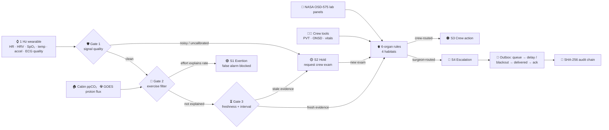
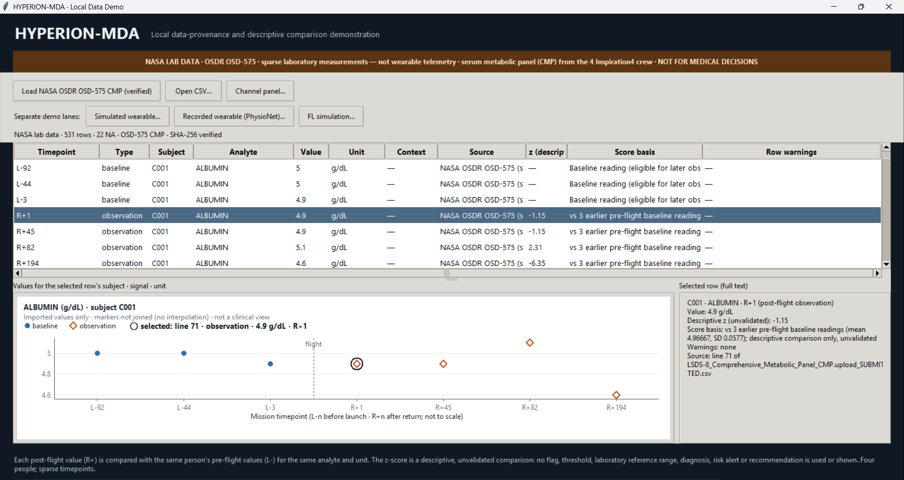

<h1 align="center">🛰️ HYPERION-MDA</h1>
<h3 align="center">Deep-Space Crew Health Monitoring</h3>

<p align="center">
  <a href="https://www.spaceappschallenge.org/"></a>
  
  
  
  
  
  
</p>

**HYPERION-MDA** is an offline-first medical web workstation for the **NASA Space Apps Challenge (Crew Health Monitoring)**. It helps astronauts and flight surgeons watch **6 organ systems** across **4 space habitats**, and it keeps working through **20-minute Mars communication delays** by holding uncertain alarms and queuing confirmed ones for Earth.

> ⚕️ Research prototype. Not a medical device, not clinically validated, no live astronaut sensor. Every simulated value is badged **Simulated** in the UI and the API.

---

## 1. 🎯 The Problem & Our Solution

| Deep-Space Problem | Real-Life Example | How HYPERION-MDA Solves It |
| :--- | :--- | :--- |
| 🏃 **Exercise false alarms** | Crew exercise ~2 h/day. Heart rate passes 150 bpm on the cycle ergometer and a simple monitor calls it cardiac risk. | **Gate 2 — exertion filter:** compares the rate with a saturating model of this person's own activity scale (3-axis acceleration) plus cabin `CO₂` drive, and blocks the alarm when effort explains it. A hard 180 bpm ceiling and a 120 s hold timeout are never suppressed. |
| 🩸 **Microgravity baseline shift** | In `0g` fluid moves toward the head, so Earth hospital cutoffs no longer describe a healthy crew member. | **Personal Z-scores:** heart rate is scored against the person's own resting calibration, not a fixed Earth average. Organ checks use visible **demo rules**, each labelled with its source and validity window. |
| 📡 **Stale checks & blackouts** | Wearables stream every second, but an eye ultrasound or reaction test can be days old when the radio drops. | **Freshness decay + Gate 3 hold:** every manual check ages as $\tau = e^{-\lambda \Delta t}$. Below `τ = 0.5` the case enters **S2 Hold** and asks for the fastest crew self-check. Confirmed alerts wait in a store-and-forward outbox until the link returns. |

---

## 2. ⚙️ How It Works



**🧑‍🚀 Three crew tools** — 🧠 reaction timer (**PVT**, ms) · 👁️ ultrasound caliper (**ONSD**, mm, for SANS) · ⌨️ vitals logger (blood pressure, glucose, temperature, hydration, sleep, mood).

**🫀 Six organ systems** — Head & Eyes (neuro-ocular/SANS) · Heart & Vessels · Chest & Immune (radiation) · Metabolic & Gut · Bones & Muscles (renal) · Brain & Sleep (behavioural/circadian).

**🌗 Four habitats** — Station `0g` (0.2 s demo link) · Transit `0g` (12 s demo = 20 min Mars scale) · Lunar Base `0.16g` (1.3 s) · Rover EVA (blackout queue).

**🛡️ Three deterministic gates** — no LLM and no neural network in the decision path; every verdict is a pure, testable function:
1. **Gate 1 — Sensor SQI:** ECG kurtosis and slew-rate checks against the person's calibration. Uncalibrated returns `UNKNOWN`, never `PASS`.
2. **Gate 2 — Exercise filter:** removes the expected effort response; non-rate findings (eye, glucose, temperature, radiation) are never suppressed.
3. **Gate 3 — Freshness & uncertainty:** split-conformal demo interval + `τ` staleness. Holds escalation and names the exact exam to run next.

---

## 3. 🧩 Why Each Component Is Used

| Component | What Is Actually Built | Engineering Trade-Off |
| :--- | :--- | :--- |
| 📉 **Baselines & core ML** | `NumPy` + `SciPy`: ridge regression and multinomial logistic regression, evaluated **Leave-One-Participant-Out** | Spaceflight cohorts are tiny. We fixed the protocol before running it and report the negative result honestly, instead of shipping an over-fitted network. |
| 🔐 **Federated learning & privacy** | `NumPy` FedAvg / DP-SGD with exact RDP accounting + cosine-median filter, 4 participant silos | Raw biosignals must not cross the radio link. Silos exchange weight updates only. Privacy is **window-level** in one process — not a deployed multi-habitat system. |
| 🔗 **Tamper-evident audit** | Python `hashlib` **SHA-256** chain in SQLite; `HealthAudit.sol` kept as a reference contract | A public chain is too slow and heavy for a spacecraft, and medical values must never go on-chain. Only linked 32-byte digests are stored. **Local chain, not a blockchain; the contract is not deployed.** |
| 🖥️ **Workstation & API** | `FastAPI` + `SQLite` + `React` + `TypeScript` + `Tailwind CSS`, one port, server-sent events | Runs offline in one container with no cloud dependency. Fonts are bundled locally; the demo needs no CDN. |

🧪 *Specified but not implemented:* PyTorch MLP, MC-Dropout uncertainty, Flower, Opacus, live habitat clients. The conformal interval runs on simulated demo residuals and carries **no coverage guarantee** on real data.

---

## 4. 📊 Data Sources & Honest Provenance

| Lane | Source | Role in the Repository |
| :--- | :--- | :--- |
| 🧪 **Astronaut labs** | **NASA OSDR `OSD-575`** — Inspiration4 serum metabolic panel | SHA-256-verified CSV, **531 rows**, 22 missing values kept visible, 4 crew, sparse pre/post-flight comparison. Fetched separately, never used to train a model. |
| ⌚ **Human wearables** | **PhysioNet Wrist PPG During Exercise v1.0.0**, `n=8`, 19 records | Real terrestrial exercise waveforms → derived windows for replay, LOPO benchmarks and the FL/DP study. **Not astronaut data.** |
| ☢️ **Space weather** | **NOAA/NASA GOES** integral proton flux (`pfu`) | Live or cached solar proton flux with availability and cache age shown. Satellite environment data, not cabin dose. |
| 🎬 **Mission scenarios** | **Simulated scenario engine** | 5 badged demo cases: Nominal 0g · Exercise False-Alarm · SANS + Stale Eye Scan · Solar Radiation Spike · Glycemic & Sleep Drift. Never merged into a real lane. |

<p align="center">
  
  <br><sub>📸 Recorded evidence from the desktop data-provenance view: the same verified OSD-575 adapter feeds the web lab drawer. Descriptive z-scores only — no diagnosis, no clinical cutoffs.</sub>
</p>

**Measured results (not slides):**

| Check | Result | Honest reading |
| :--- | :--- | :--- |
| LOPO heart rate | ridge **23.67 bpm** vs no-signal baseline **24.18 bpm** | Difference CI includes 0 → **no demonstrated win** at n=8. |
| LOPO activity | **0.733** accuracy · **0.731** macro-F1 (walk/run/cycle) | Beats majority class; adding PPG gave no measurable gain. |
| DP sweep | ε **30.36 → 0.51** (δ=1e-5), MAE **25.45 → 28.10** | Real privacy/utility cost, window-level only. |
| Radiation-style attack | FedAvg **diverged 5/5** under scale attack; cosine-median held at **28.92** | Robust aggregation matters more than the average case. |

📁 [LOPO report](experiments/m6/outputs/report.md) · [Results summary](docs/M6-RESULTS-SUMMARY.md) · [FL/DP artifact](artifacts/fl_dp_benchmark_results.json) · [OSD-575 notes](docs/OSDR-OSD575-DATA.md) · [Safety issues](docs/SAFETY_ISSUES.md) · [Architecture](docs/ARCHITECTURE.md) · [Demo guide](docs/MENTOR-DEMO-GUIDE.md)

---

## 5. 🚀 Quick Start

Verified on Linux, Python 3.11 and Node.js 22. Run from the repository root.

```bash
# 1) install dependencies
python3 -m venv .venv-api
.venv-api/bin/python -m pip install -r requirements-api.txt
cd web && npm ci && npm run build && cd ..

# 2) start API + built UI on one port
HOST=127.0.0.1 .venv-api/bin/python backend_api.py
```

➡️ Open **http://127.0.0.1:8000** — Crew Workstation `/` · Overview `/overview` · ML & Docs `/docs`. No dataset download is needed; the default case is badged **Simulated**.

```bash
# offline rerun after first setup (no registry access)
HOST=127.0.0.1 bash run_workstation.sh --offline

# optional hot reload: keep the backend running, second terminal
cd web && npm run dev            # http://127.0.0.1:5173, proxies /api to :8000

# container path (config provided; not built in our verification environment)
docker compose up --build        # http://127.0.0.1:8000
```

🪟 Windows: use `.venv-api\Scripts\python.exe` in place of `.venv-api/bin/python`.

**✅ Verification (already run in this repo):**

```bash
export PYTHONPATH=src
.venv-api/bin/python -m pytest -q                              # 316 passed, 49 skipped
.venv-api/bin/python -m pytest tests_api -q                    # 152 passed, 79 subtests
(cd web && npm run test)                                       # 48 passed, 10 files
.venv-api/bin/python experiments/m6/verify_m6.py               # 1187 checks, 0 failed
.venv-api/bin/python scripts/run_fl_dp_benchmark.py --verify    # artifact reproduced
.venv-api/bin/python scripts/smoke_workstation.py --base http://127.0.0.1:8000   # 58 passed
```

Skips are explicit: no Tkinter and no optional raw dataset caches in the verification environment. Frontend tests use jsdom; no real-browser E2E run was available.

**🗂️ Where to look:** `api/` routes, gates, workflow, lanes · `web/` React UI · `src/hyperion_mda/` data adapters + desktop prototype · `experiments/m6/` frozen LOPO protocol · `artifacts/` FL/DP result · `docs/` runbooks and verification reports · `demo-evidence/` recorded logs and screenshots.

🔭 Research context: [NASA HRP hazards](https://www.nasa.gov/hrp/hazards/) · [OSD-575 study](https://osdr.nasa.gov/osdr/data/osd/meta/575) · [PhysioNet wrist dataset](https://physionet.org/content/wrist/1.0.0/) (ODC-By 1.0, Jarchi & Casson 2017) · [NOAA SWPC](https://www.swpc.noaa.gov/). References only — no agency endorsement.
